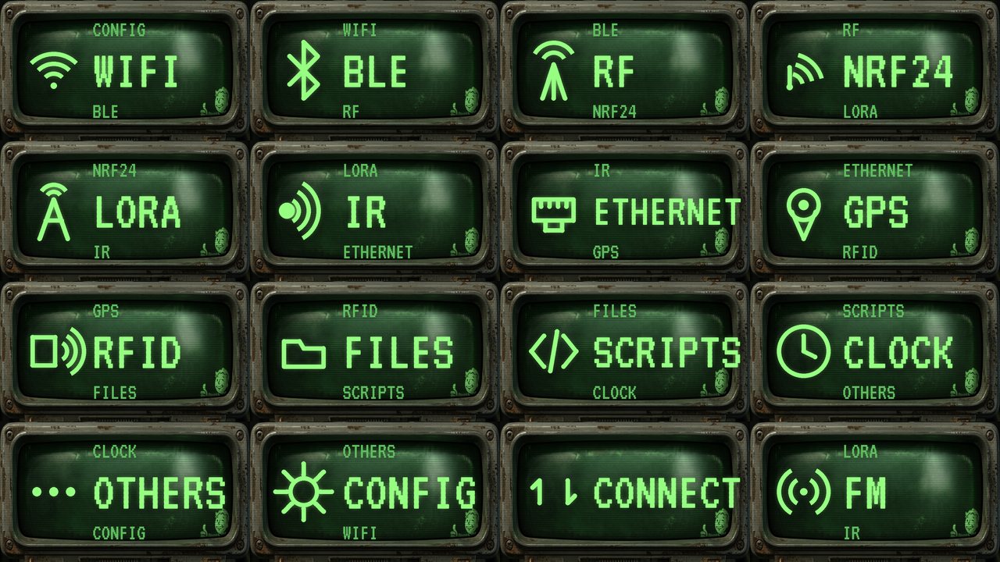

# ☢️ Fallout Pip-Boy — Bruce Theme

🇺🇸 <b>English</b> · 🇫🇷 <a href="README.fr.md">Français</a>

  

A **Fallout Pip-Boy** UI theme for the **[Bruce firmware](https://github.com/BruceDevices/firmware)** on the LilyGO T-Embed CC1101 (320×170). Rusty metal bezel, phosphor-green CRT, Vault Boy in the corner. Each menu entry shows a green picto on the left and a **VT323 terminal** stack on the right: previous item (small), current item (large), next item (small).

## 🎮 Look

The menu label is **baked into the image** (`label: 0`), Pip-Boy terminal style:

- 🟢 **Green picto** of the current entry on the left (phosphor glow + CRT scanlines).
- 🔠 On the right, top to bottom: **previous** (small font) · **CURRENT** (very large) · **next** (small font).
- ⚙️ 14 hand-drawn pictos: WiFi, BLE, RF, NRF24, LoRa, IR, Ethernet, GPS, RFID, Files, Scripts, Clock, Others, Config (+ FM & Connect).

## 📦 Contents

`Fallout_PipBoy/` contains **4 sizes** (one per Bruce screen template), each with **16 PNGs** + its `.json`:

| Folder | Image | Target screen |
|---|---|---|
| `105px/` | 240×105 | M5StickC Plus (240×135) |
| `140px/` | 320×140 | **T-Embed CC1101 / Cardputer (320×170)** |
| `180px/` | 320×180 | ~320×210 screens |
| `192px/` | 320×192 | ~320×222 screens |

> ℹ️ **Status bar** — Bruce reserves **30 px at the top** (battery / time / WiFi). The right size = **your screen height − 30**. For the **T-Embed CC1101 (320×170) → `140px`**. The firmware draws the image below the status bar, so the icons don't overlap the bezel and don't flicker when you switch menus.

## 🚀 Installation

1. Copy the **`Fallout_PipBoy`** folder to the root of the SD card.
2. On the device: **Config → UI Theme → `Fallout_PipBoy/<size>/Theme_Fallout_PipBoy.json`** (size = screen height − 30; **`140px` for the T-Embed CC1101**).
3. Over WiFi: **Files → WebUI**, upload the folder, then select the `.json`.

## ⚠️ Menu order (neighbours)

The **previous / next** labels are painted into each image following the **default order** of the Bruce T-Embed CC1101 menu:
`WiFi → BLE → RF → NRF24 → LoRa → IR → Ethernet → GPS → RFID → Files → Scripts → Clock → Others → Config` (looping).

If you **disable or reorder** menus (`Config → Main Menu`), the neighbours shown will no longer match. In that case, open an issue with your exact order and I'll regenerate the theme for your setup.

## 🛒 Hardware

*Amazon affiliate links: if you buy through these links, the project earns a small commission at no extra cost to you.*

<table>
<tr>
<td align="center" width="33%">
   
  <b><a href="https://www.amazon.com/dp/B0D45MSMJR?linkCode=ll2&amp;tag=koua29bfallouttheme-20&amp;ref_=as_li_ss_tl">Anker 545 power bank (10,000 mAh)</a></b> Keeps the T-Embed running away from an outlet
</td>
<td align="center" width="33%">
   
  <b><a href="https://www.amazon.com/dp/B0C1FCZM94?linkCode=ll2&amp;tag=koua29bfallouttheme-20&amp;ref_=as_li_ss_tl">433 MHz SMA antenna (2-pack)</a></b> Sub-GHz antenna for the CC1101 radio
</td>
<td align="center" width="33%">
   
  <b><a href="https://www.amazon.com/dp/B0B7NVMBPL?linkCode=ll2&amp;tag=koua29bfallouttheme-20&amp;ref_=as_li_ss_tl">SanDisk 64 GB microSD (2-pack)</a></b> For Bruce themes, scripts and captures
</td>
</tr>
</table>

As an Amazon Associate I earn from qualifying purchases.

## 🎨 Credits

- Pip-Boy background & theme by **koua29**.
- Rendering font: **[VT323](https://fonts.google.com/specimen/VT323)** (SIL Open Font License).
- Runs on the excellent **[Bruce firmware](https://github.com/BruceDevices/firmware)**.

## ☕ Buy me a coffee

If you like this theme:

## 📄 License

**MIT** — see [LICENSE](LICENSE). Fallout / Pip-Boy / Vault Boy are trademarks of Bethesda; this theme is an unofficial fan project, not affiliated.
